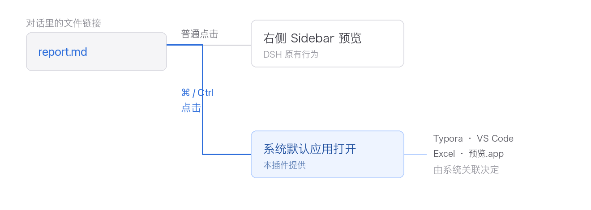

# dsh-skip-preview

[English](#english) | 中文

在 DSH 对话里按住 **⌘**（Windows/Linux 为 **Ctrl**）点击文件链接，**跳过右侧预览，直接用系统默认应用打开**。普通点击不变，仍然是右侧 Sidebar 预览。



## 解决什么问题

DSH 里对话正文提到的文件，点击后一律进右侧侧边栏预览。这在不少场景下不是想要的结果：

- **小屏幕上侧栏太窄。** 右侧面板宽度可以拖动调整，但它要和主对话区分享屏幕：在笔记本等小屏上，把侧栏拉宽就等于挤掉对话本身，怎么调都别扭。长 Markdown、PDF、表格在这种空间里很难读——把文件交给外部程序，等于借用整个屏幕。
- **想直接改。** 你本来就打算在编辑器里改它，多一次「先进预览、再点打开」是无谓的一步。
- **系统程序更合适。** `.md` 用你的编辑器、`.xlsx` 用 Excel / WPS、`.pdf` 用系统预览器——DSH 内置预览只是其中一个选项。

本插件给预览加一条**并行出口**，而不是替换预览：想看就看，想用外部程序就按住 ⌘ 点。

## 用法

| 操作 | macOS | Windows / Linux |
|---|---|---|
| 左键点击文件链接 | 预览（DSH 原有行为） | 预览（DSH 原有行为） |
| **⌘ + 左键** | **用系统默认应用打开** | —（无 ⌘ 键） |
| **Ctrl + 左键** | 预览（macOS 上 Ctrl+点击是系统右键） | **用系统默认应用打开** |
| 带 Shift / Alt / 另一个修饰键 | 一律预览 | 一律预览 |
| 打开失败时 | 自动退回预览，Console 记录原因 | 同左 |

触发键**只认一个**，按平台判定：macOS 认 `metaKey`（⌘），Windows/Linux 认 `ctrlKey`。除这一个组合外，插件**不接管任何点击**，全部原样交回 DSH 和浏览器。

> 具体用哪个应用由系统文件关联决定。`.md` 的默认程序取决于你的系统设置，本插件不指定、也不修改它。

## 覆盖范围

包装的是 `sidebarRight.openResource`——会话正文里的文件进入右侧面板的唯一入口，因此以下都生效：

- 正文里的 Markdown 链接（`[report.md](report.md)`）
- 行内代码里的路径（`` `docs/spec.md` ``）
- 右侧文件树中点击文件

**不覆盖**：`present` 出来的交付卡片，它走 `ui-deliverables` 自己的路由。

## 安装

```sh
dsh plugin --profile desktop add dsh-skip-preview
```

装完**完全退出并重启 DSH**。刷新页面不足以重载客户端 bundle。

从源码安装：

```sh
dsh plugin --profile desktop add github:finalrgy/dsh-skip-preview
```

## 兼容性

- 需要 DSH `>= 0.2.1-rc.5`（见 `package.json` 的 `dsh.engines.dsh`）。
- 启动时做**自检**：若 DSH 改了 `sidebarRight.openResource` 等方法名，Console 会打印 `[dsh-skip-preview] 启动自检失败` 并说明受影响的行为，而不是静默失效。

## 实现要点

- **在服务层包装，不碰 DOM。** 正文文件链接是 `<button class*="fileLink">`，行内代码路径是 `<code><button title=…>`，两套 DOM 形状；而它们最终都经过 `openResource`，包一处即覆盖全部入口，也不受 DSH 改样式类名影响。
- **修饰键取自捕获阶段。** `openResource(address)` 只收到地址、拿不到事件，所以在 `pointerdown` / `click` 的捕获阶段记录真实按键（早于 React 根容器的冒泡监听）。
- **失败回退预览。** 宿主拒绝时（路径不在工作区、文件不存在）会 throw 或回 `ok:false`，两种都退回预览，避免「点了没反应」。
- **幂等 + 可还原。** 重复 apply 不会重复包装；卸载时只在仍是自己那层包装时才还原，不踩别人后来的包装。

## 已知限制

- **依赖 `sidebarRight.openResource` 这个方法名。** 它是 DSH 的公开服务面，但方法签名不是稳定契约。已有启动自检兜底，仍可能因 DSH 升级而失效。
- **手势快照是全局单例。** 任意一次点击都会覆盖它。1 秒 TTL 把影响压得很小，但没有根除。
- **触发键写死在代码里。** 没有设置项；要换键得改 `TRIGGER_IS_META` 附近几行。
- **可发现性为零。** 界面没有任何提示，纯靠记忆。
- **Windows/Linux 未实测。** `ctrlKey` 分支有测试覆盖，但没在真实 Windows 环境跑过。
- **不支持交付卡片。** 见「覆盖范围」。

## 维护文档

- [`AGENTS.md`](https://github.com/finalrgy/dsh-skip-preview/blob/main/AGENTS.md) — 维护这个插件必读的上下文（自动注入给新建会话的 agent）
- [`docs/decisions.md`](docs/decisions.md) — 决策记录与踩坑（随包发布）
- **DSH 插件开发通用知识** — 在本地 `~/own/20_tools/dsh-plugins/README.md`，所有插件共用，不随本包发布

## License

MIT

---

<a id="english"></a>
## English

Hold **⌘** (**Ctrl** on Windows/Linux) and click a file link in a DSH conversation to **skip the right sidebar preview and open the file with your system default application**. A plain click still previews, exactly as before.


### Why

DSH opens every file mentioned in chat in the right sidebar. That is often not what you want. The sidebar width is adjustable, but it has to share the screen with the conversation: on a laptop, widening it just squeezes the chat, so no setting feels right. Long Markdown, PDFs and spreadsheets are hard to read in that space — handing the file to an external app borrows the whole screen instead. And if you were going to edit the file anyway, the preview is a wasted step. This plugin adds a **parallel exit** rather than replacing the preview.

### Behaviour

| Action | Result |
|---|---|
| Plain click | Sidebar preview (unchanged DSH behaviour) |
| **⌘ + click** (macOS) / **Ctrl + click** (Windows/Linux) | Opens with the system default app |
| Shift / Alt / the other modifier | Always previews — never intercepted |
| Host rejects the open | Falls back to preview, logs the reason |

Only that one combination is intercepted; every other click is passed through untouched. Which application handles a file is decided by your OS file associations — the plugin does not pick or change it.

### Scope

Wraps `sidebarRight.openResource`, the single entry through which conversation files reach the right panel, so all of these work:

- Markdown links in message bodies (`[report.md](report.md)`)
- Paths in inline code (`` `docs/spec.md` ``)
- Clicking a file in the right-hand file tree

**Not** covered: `present` deliverable cards, which use `ui-deliverables`' own route.

### Install

```sh
dsh plugin --profile desktop add dsh-skip-preview
```

Fully quit and restart DSH afterwards; a page refresh does not reload the client bundle.

From source:

```sh
dsh plugin --profile desktop add github:finalrgy/dsh-skip-preview
```

### Compatibility

Requires DSH `>= 0.2.1-rc.5` (see `dsh.engines.dsh`). A startup self-check logs an explicit error if DSH renames the wrapped service methods, instead of failing silently.

### How it works

- **Service-layer wrapping, no DOM.** Conversation file links are `<button class*="fileLink">` while inline-code paths are `<code><button title=…>` — two DOM shapes. They all funnel through `openResource`, so wrapping that single entry covers every source and survives CSS-module renames.
- **Modifier state read in the capture phase.** `openResource(address)` receives only the address, not the event, so the real key state is recorded on `pointerdown` / `click` during capture, before React's root-container bubble listener runs.
- **Falls back to preview on failure.** If the host rejects the open (path outside the workspace, missing file) it throws or returns `ok: false`; both fall back to the preview so nothing silently does nothing.
- **Idempotent and reversible.** Repeated applies do not double-wrap; unwrapping only restores its own layer, never a later wrapper installed by someone else.

### Known limitations

- **Depends on the `sidebarRight.openResource` method name.** It is a public service surface but not a stable signature contract. The startup self-check makes breakage loud, but DSH upgrades may still require an update.
- **The gesture snapshot is a module-level singleton.** Any click overwrites it. A 1-second TTL keeps the impact small but does not eliminate it.
- **The trigger key is hardcoded.** No setting; changing it means editing the lines around `TRIGGER_IS_META`.
- **Zero discoverability.** Nothing in the UI hints that ⌘+click exists.
- **Windows/Linux untested.** The `ctrlKey` branch has test coverage but has not run on a real Windows machine.
- **Deliverable cards not covered.** See Scope.

### License

MIT
